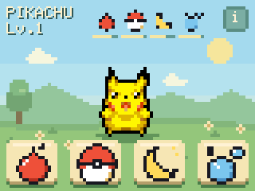
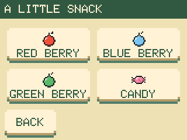
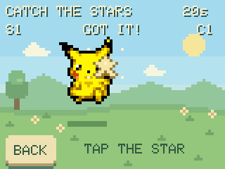
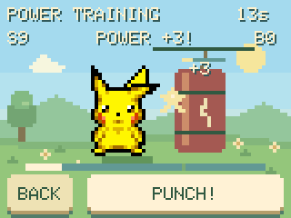
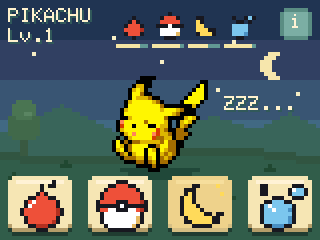
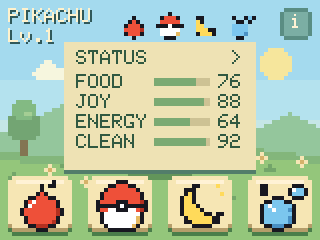
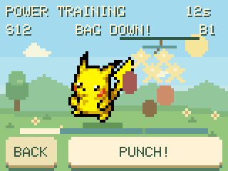

# TamaPoke CYD


把皮卡丘養在 **ESP32-2432S028 CYD 2.8 吋觸控板**上。滿版像素草地、四個照顧圖示、三款小遊戲；USB 供電，**4 MB Flash、無須 PSRAM 或 microSD**。

**[開啟網頁燒錄工具](https://maxxtang.github.io/TamaPoke-CYD/)** · [下載韌體備份包](https://github.com/MAXXTANG/TamaPoke-CYD/releases/tag/v0.4.0) · [完整安裝與操作](docs/cyd/README.md) · [驗證紀錄](docs/cyd/VALIDATION.md) · [28 張介面截圖](docs/cyd/screens/overview.png)

目前版本：`0.4.0-cyd`。ST7789 版已實機刷入並確認照顧功能與三款遊戲；ILI9341 版已完成編譯與主機測試，尚未上板。這個 repo 為 CYD 獨立版本，原始微雪版位於 [TamaPoke-Pikachu](https://github.com/MAXXTANG/TamaPoke-Pikachu)。

## 畫面與玩法

| 滿版主畫面 | 餵食與照顧 |
| --- | --- |
|  |  |

| 節奏擊掌 | 追星跳接 | 蓄力出拳 |
| --- | --- | --- |
|  |  |  |
| 12 拍，跟著亮區擊掌與連擊。 | 20 秒，接下落星星，漏接後可繼續。 | 15 秒，自動蓄力、三段力道、沙包擊破。 |

| 晚安場景 | 需求狀態 | 沙包擊破 |
| --- | --- | --- |
|  |  |  |

這些介面截圖由**與韌體相同的繪圖程式**產生，使用示例存檔，並非 LCD 攝影。來源與雜湊在 [provenance.json](docs/cyd/screens/provenance.json)。另保留 [0.2.0 裝置端像素擷取](evidence/cyd/device-frame-0.2.0.png)。封面以 AI 生成場景搭配既有像素角色合成，見 [封面來源](docs/images/COVER.md)。

## 安裝

1. 使用電腦版 Chrome 或 Edge，打開 **[網頁燒錄工具](https://maxxtang.github.io/TamaPoke-CYD/)**。
2. 以 USB 資料線接上板子，核對 ST7789 或 ILI9341；雙 USB 版可沿用 USB-A → Micro-USB。
3. 選擇「保留存檔更新」或「首次安裝」，再點「連接並檢查」。
4. 完成確認後開始寫入。首次安裝需要在板上完成四點校正，再用網頁同步時間。

**首次安裝會清除板上的原程式、角色與校正。** 保留存檔更新僅適用本 CYD 版 0.1.1 以上、相同分割表；工具會在寫入前比對分割表，更新後再比對完整 NVS 存檔區。初次改裝前可依[進階說明](docs/cyd/README.md#首次安裝與備份)備份原 Flash，備份保留在自己的電腦。

| 版本 | 建置環境 | 韌體套件 | 實機範圍 |
| --- | --- | --- | --- |
| 雙 USB／ST7789 | `cyd-st7789` | [bin 與 SHA-256](firmware/cyd/cyd-st7789/) | 已刷入與使用者確認 |
| 單 USB／ILI9341 | `cyd-ili9341` | [bin 與 SHA-256](firmware/cyd/cyd-ili9341/) | 僅交叉編譯與主機檢查 |

LCD 型號仍以板子的實際規格為準。此韌體使用**傳統 ESP32**；微雪 ESP32-S3 版不可互刷。

## 操作

| 操作 | 功能 |
| --- | --- |
| 底部樹果／精靈球／月亮／泡泡 | 餵食、遊戲、睡覺或喚醒、清潔 |
| 點皮卡丘 | 摸摸；符合條件時進化或告別 |
| 右上 i，再點視窗內 > | 需求數值、角色資料、圖鑑與設定 |
| BOOT 短按 | 返回主畫面；遊戲提早離開不發獎勵 |
| BOOT 長按 3 秒／6 秒 | 設定／重新四點校正 |

內建皮卡丘與雷丘的一般、異色動畫。使用英文介面；目前沒有音效、完整 151 隻素材、Wi-Fi 校時、電池管理與低功耗喚醒。每次重開機後可由 USB 校時；一般養成計時不需要連網。

## 開發與驗證

```sh
python3 -m pip install platformio==6.2.0 pyserial
pio run -d cyd -e cyd-st7789
pio run -d cyd -e cyd-ili9341
make -C TamaPoke/test run asan
python3 -m unittest discover -s test -p 'test_*cyd*.py' -v
node --test test/web-*.test.mjs
python3 tools/render_cyd.py
python3 tools/check_cyd_design.py
python3 tools/check_cyd.py
python3 tools/build_web.py
python3 tools/check_web.py
```

固定使用 espressif32 6.5.0、Arduino-ESP32 2.0.14、TFT_eSPI 2.5.43。主機繪圖與網站整理只用 Python 標準函式庫，網頁檢查使用 Node.js 22 以上；瀏覽器燒錄器內建固定版本 esptool-js 0.6.0 與 CryptoJS 4.2.0，不依賴外部 CDN。

`0.4.0-cyd` 的 182 項主機測試與 ASan／UBSan 通過；實機更新前後 20,480-byte NVS 完全相同，遊戲操作期間可用 heap 維持 331,956 bytes。詳細證據見 [VALIDATION.md](docs/cyd/VALIDATION.md)。網站檢查與真實瀏覽器寫入的驗證範圍另見 [WEB_INSTALLER.md](docs/WEB_INSTALLER.md)。

`cyd/` 是正式建置入口。`TamaPoke/` 保留共用遊戲 core、素材及回歸測試，包含歷史微雪 sketch 作為來源參考；建置 CYD 不會編譯該 sketch。匯出版本記錄見 [SOURCE_SNAPSHOT.json](docs/SOURCE_SNAPSHOT.json)。

## 授權與致謝

原 TamaPoke 程式由 Quique Tortosa 開發，程式碼依 [MIT License](LICENSE) 公開；角色素材與名稱的權利另列，**僅供個人與非商業粉絲用途**。請保留 PMD SpriteCollab、Nintendo／Game Freak／The Pokémon Company 的標示，見 [第三方聲明](THIRD_PARTY_NOTICES.md) 與 [原專案致謝](docs/UPSTREAM_CREDITS.md)。本專案與上述公司沒有隸屬或背書關係。
