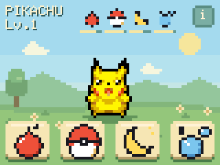
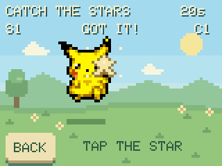
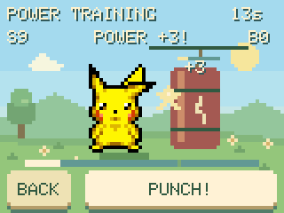

# TamaPoke CYD 像素版

更新：2026-11-24 · `0.4.0-cyd` · 公開分支 `main`

這是給 **ESP32-2432S028、4 MB Flash、無 PSRAM** 的獨立韌體。0.4.0 重做接星星與力量訓練的動作及玩法，沿用已驗收的滿版場景、四個照顧圖示與節奏擊掌。兩種螢幕版本均可編譯；ST7789 上板與存檔保留的驗證範圍見 [驗證紀錄](VALIDATION.md)。



以上及 [28 張畫面總覽](screens/overview.png) 都由 CYD 韌體的同一份繪圖函式在主機產生，使用示例存檔；不是實機照片。來源雜湊見 [provenance.json](screens/provenance.json)。另保留 [0.2.0 板上繪圖擷取](../../evidence/cyd/device-frame-0.2.0.png)，由 USB 讀回實機產生的畫素，並非 LCD 攝影。

主畫面採 80×60 像素格，每格對應 4×4 LCD 像素；角色、草地、山丘與大圖示共用同一比例，文字為 2 倍點陣字。皮卡丘 idle 首影格為 76×100 像素。已保存[核准版面](design/approved-layout.html)，預設靜止畫面轉成 RGB565 後，與韌體的 76,800 個像素完全一致。

## 這版可以做什麼

- 第一次建立存檔時直接開始養皮卡丘；保留原遊戲的等級、需求、親密度、訓練、進化與 NVS 存檔。
- 內建皮卡丘、雷丘的一般／異色動畫，直接從 Flash 讀取，不需要 microSD。
- 橫向 320×240 介面：餵食、摸摸、睡眠／喚醒、清潔、節奏擊掌、接星星與力量訓練。
- 角色資料、皮卡丘／雷丘登錄狀態、20／50／100% 亮度、180° 旋轉與四點觸控校正。
- 進化、告別與放生都有確認畫面；新一輪仍由皮卡丘的蛋開始。

這版採 USB 供電，介面使用英文。音效、完整 151 隻素材、microSD、Wi-Fi 校時、電池管理與省電喚醒尚未移植；也沒有原版完整圖鑑、改名鍵盤與多語言介面。軟體時鐘在重新啟動或斷電後需經 USB 重新校時，才會計算離線經過時間與每日連續照顧；一般養成計時不需要連網。

## 選擇板型

| 實體板型 | 建置環境 | 預編譯套件 |
| --- | --- | --- |
| 先前臺鐵看板使用的雙 USB／ST7789 版 | `cyd-st7789`，預設 | [韌體與 SHA-256](../../firmware/cyd/cyd-st7789/) |
| 單 USB／ILI9341 版 | `cyd-ili9341` | [韌體與 SHA-256](../../firmware/cyd/cyd-ili9341/) |

板型、LCD 接腳、BGR 色序與 XPT2046 分開走 SPI 的設定，依 [既有車站看板](https://github.com/MAXXTANG/tra-station-board) 的 CYD 設定實作。本次實機為 ESP32-D0WD-V3、4 MB、雙 USB／ST7789；ILI9341 僅完成編譯與主機檢查。其他板子仍須核對 LCD 型號。

**微雪 ESP32-S3 韌體與本版 ESP32 韌體不能互刷。現有公開網頁安裝器仍是微雪版。**

## 操作

| 操作 | 功能 |
| --- | --- |
| 點底部樹果／精靈球／月亮／泡泡圖示 | 餵食、遊戲、休息或喚醒、清潔 |
| 點角色 | 摸摸；符合條件時開啟進化／告別選擇 |
| 主畫面長按角色 3 秒 | 放生確認，選 KEEP 可取消 |
| 點右上 i | 展開或收起需求數值視窗；點外側只關閉視窗 |
| 點需求視窗右上 > | 角色資料，再進入 DEX 或 SETUP |
| BOOT 短按 | 返回主畫面，遊戲中提早離開不發獎勵 |
| BOOT 長按 3 秒後放開 | 開啟設定 |
| BOOT 持續按到 6 秒 | 重新觸控校正；適合原校正值無法操作時使用 |

首次沒有有效校正值時，先進入四點校正。依序按住十字約 0.2 秒再放開；第四點不一致會重做，通過才保存。校正在固定原始方向進行，完成後恢復已保存的旋轉方向。

兩款遊戲先顯示準備畫面，點 START 才開始倒數。每次要抬起手指再點，持續按住不會連續計分；BACK 或 BOOT 提早離開不發獎勵。

### 接星星

點 `START CATCH`，在 20 秒內點下落的星星。皮卡丘會追上並跳起接住，連續命中增加連擊；漏接只中斷連擊，仍能繼續玩完整局。星星有尾跡、剩餘時間條與額外觸控範圍，後半局逐漸加快；接住後的短動畫期間不重複計分。結算顯示最高連擊，沿用原遊戲的快樂與速度獎勵。



### 力量訓練

點 `START TRAIN`，在 15 秒內點沙包或 `PUNCH!` 出拳。底部蓄力條會自動上升，滿格出拳得 3 分，中段 2 分、輕擊 1 分；每拳之後重新蓄力。皮卡丘向前出拳，沙包會晃動、出現裂痕，耐力耗盡後碎開並換上新沙包。結算顯示擊破數與實際增加的力量；訓練分數沿用原 core 的每 4 分增加 1 點、每局上限 18 點計算。



### 節奏擊掌

點底部精靈球 → 選單第一項 `HIGH FIVE BEAT` → 點 `START BEAT`。等游標進入亮色區域，出現 `HIGH FIVE NOW!` 時，點 `HIGH FIVE!` 或畫面中央擊掌。成功時皮卡丘抬手靠近，出現愛心、星星與 `PERFECT!`；過早、過晚或漏拍會中斷連擊。

一局 12 拍、約 18 秒，每拍只接受一次點擊。結束顯示成功次數與最高連擊，沿用原遊戲獎勵；`BACK` 或 BOOT 短按提早離開不發獎勵。回合進行中延後週期性存檔，以免寫入 Flash 打斷節奏。這版仍是視覺節拍，沒有音效。


## 編譯

```sh
python3 -m pip install platformio==6.2.0
pio run -d cyd -e cyd-st7789
pio run -d cyd -e cyd-ili9341
```

固定使用 espressif32 6.5.0、Arduino ESP32 2.0.14、TFT_eSPI 2.5.43。輸出在 `cyd/.pio/build/<環境>/`。遊戲 core 與內建素材直接編譯 `TamaPoke/` 的原始碼，微雪 sketch 不參與 CYD 建置。

每次畫一條 320×24 RGB565 區塊，緩衝區為 **15,360 bytes**；畫面、觸控共用實體座標。TPK2 動畫只建立 Flash 唯讀索引，不複製整隻角色到 RAM。編譯器列出的靜態 RAM 不包含執行時的繪圖區塊、堆疊與 heap，實際餘裕需讀取上板後的 `STATUS`。

## 首次安裝與備份

首次安裝會取代車站看板或其他原程式，並清除 NVS 設定；先保留完整 4 MB Flash 備份。本次已保存原板備份於本機 Git 排除目錄。Micro-USB 請使用資料線。

先辨識板上晶片為 **ESP32、4 MB Flash**，再備份：

```sh
python3 -m esptool --chip esp32 --port /dev/cu.usbserial-XXXX flash_id
mkdir -p .flash-backups
python3 -m esptool --chip esp32 --port /dev/cu.usbserial-XXXX read_flash 0x0 0x400000 .flash-backups/cyd-before-tamapoke.bin
```

檢查所選套件的 `SHA256SUMS` 後，以 ST7789 為例：

```sh
python3 -m esptool --chip esp32 --port /dev/cu.usbserial-XXXX --baud 115200 write_flash --flash_mode dio --flash_freq 40m --flash_size 4MB 0x0 firmware/cyd/cyd-st7789/tamapoke-cyd-factory.bin
```

`factory.bin` 是 4 MB 完整首次安裝映像，偏移 `0x0`，也會初始化最後 64 KiB 的診斷區，避免沿用舊程式的診斷資料。`app.bin` 偏移 `0x10000`，只適合**已裝本 CYD 分割表**的後續更新；不能直接假設既有車站看板或微雪板的分割表相容。此版沒有 OTA。

## USB 校時與狀態

安裝 pyserial 後，待裝置啟動再執行：

```sh
python3 tools/cyd_console.py --port /dev/cu.usbserial-XXXX --set-time
python3 tools/cyd_console.py --port /dev/cu.usbserial-XXXX
```

工具會讀取狀態，選擇 `--set-time` 才會寫入電腦的 UTC 時間，不刷機、不清除存檔。部分 USB 序列晶片在開啟連線時仍可能重置板子；逾時時等啟動完成再試。

工具會先辨識 TamaPoke CYD 狀態才送校時。從 0.1.1 更新至本版，分割表相同，可只寫 app，保留角色、亮度、旋轉與校正：

```sh
python3 -m esptool --chip esp32 --port /dev/cu.usbserial-XXXX --baud 115200 write_flash --flash_mode keep --flash_freq keep --flash_size keep 0x10000 firmware/cyd/cyd-st7789/tamapoke-cyd-app.bin
```

若仍為早期 0.1.0，還需更新 `0x8000` 的 `partitions.bin`，補齊 coredump 診斷分割區；操作前先備份。

序列埠為 115200 baud，可接受 `STATUS`、`TIME`、`TIME <UTC Unix 秒數>`、`SAVE`、`CALIBRATE` 與 `CAPTURE`。首次校時才套用離線時間，當次開機再次校時只修正時鐘。狀態會回報版本、板型、需求數值、剩餘 heap、最大連續區塊、PSRAM、繪圖區塊大小、校時、校正、完整繪圖耗時與累計畫面數。

診斷用擷取不需整張畫面 RAM，沿用 15,360-byte 區塊與 640-byte 暫存列。傳輸約 14 秒，其間暫停觸控處理；建議在主畫面靜止時擷取：

```sh
python3 tools/capture_cyd.py --port /dev/cu.usbserial-XXXX --set-time --output cyd-screen.png
```

## 驗證與下一步

```sh
make -C TamaPoke/test run asan
python3 -m unittest discover -s test -p 'test_*cyd*.py' -v
python3 tools/render_cyd.py
python3 tools/check_cyd_design.py
python3 tools/check_cyd.py
```

CI 另有兩個 CYD 環境的編譯工作。實際執行結果以 [VALIDATION.md](VALIDATION.md) 為準；發布到 GitHub 前，不能把本機通過當成遠端 CI 已通過。

0.2.0 的滿版／四圖示及 0.3.0 節奏擊掌已經使用者確認。0.4.0 接星星與力量訓練也已上板，使用者回覆兩款的畫面與體驗都有改善；本輪結果見驗證紀錄。亮度與 180° 旋轉、真正斷電保存及長時間運行仍待驗證。

程式與角色素材沿用原專案的 [授權](../../LICENSE) 與 [第三方標示](../../THIRD_PARTY_NOTICES.md)；角色圖像仍屬非商業粉絲用途。
